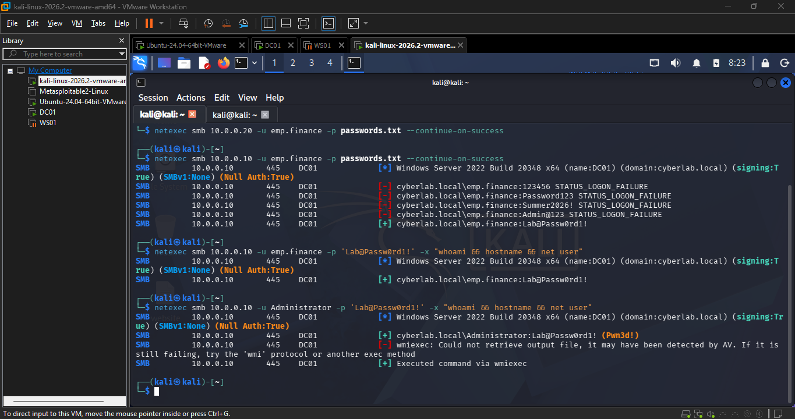
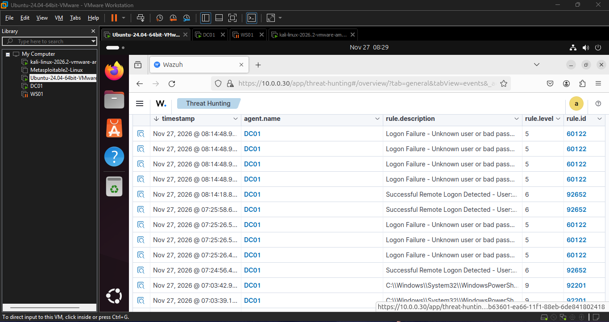
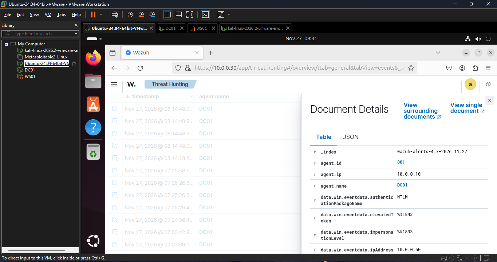

# 🔍 Brute-Force Attack Investigation & GRC Policy Remediation

An end-to-end **SOC Incident Investigation** and **Governance, Risk & Compliance (GRC)** case study simulating an SMB credential brute-force attack against a Windows Server 2022 Domain Controller (`DC01`), reconstructing the exact attack timeline in **Wazuh SIEM 4.11.2**, and authoring formal authentication policy controls.

---

## 📋 Executive Summary

* **Incident Type:** Credential Brute-Force & Unauthorized Remote Logon (`MITRE ATT&CK T1110.001`)
* **Target Asset:** `DC01.cyberlab.local` (`10.0.0.10` — Windows Server 2022)
* **Compromised Account:** `CYBERLAB\emp.finance` (followed by administrative post-exploitation check)
* **Attacker Source IP:** `10.0.0.50` (`Kali-Attacker`)
* **Detection Stack:** Wazuh SIEM `4.11.2` + Windows Security Auditing (`Event IDs 4625, 4624, 4688`) + Sysmon

---

## ⚔️ Attack Simulation & Execution (`Kali Linux`)

Using `netexec` over SMB (`TCP/445`), a targeted password list (`passwords.txt`) was tested against the domain account `emp.finance`. After four failed authentication attempts (`STATUS_LOGON_FAILURE`), the fifth attempt succeeded, granting authenticated access to the target host.

---

## 🕒 SOC Investigation & Attack Timeline (`Wazuh SIEM`)

Correlating Windows Security Event Logs inside **Wazuh Threat Hunting** revealed a clear sequence of rapid authentication failures immediately followed by a successful remote logon from source IP `10.0.0.50`:

| Timestamp (UTC/Lab) | Host | Windows Event ID | Wazuh Rule ID | Severity | Event Description & Forensic Finding |
| :--- | :--- | :---: | :---: | :---: | :--- |
| `08:14:48.9` | `DC01` | `4625` | `60122` | Level `5` | **Logon Failure #1** — Bad password (`123456`) for `emp.finance` from `10.0.0.50`. |
| `08:14:48.9` | `DC01` | `4625` | `60122` | Level `5` | **Logon Failure #2** — Bad password (`Password123`) for `emp.finance` from `10.0.0.50`. |
| `08:14:48.9` | `DC01` | `4625` | `60122` | Level `5` | **Logon Failure #3** — Bad password (`Summer2026!`) for `emp.finance` from `10.0.0.50`. |
| `08:14:48.9` | `DC01` | `4625` | `60122` | Level `5` | **Logon Failure #4** — Bad password (`Admin@123`) for `emp.finance` from `10.0.0.50`. |
| `08:14:18` – `08:22:10` | `DC01` | `4624` | `92652` | Level `6` | **Successful Remote Logon** — Valid credentials accepted (`Logon Type 3`), confirming account compromise. |
| `08:22:10+` | `DC01` | `4688` / `Sysmon 1` | `92201` | Level `9` | **Post-Exploitation Command Execution** — Host enumeration (`whoami`, `hostname`, `net user`) executed under privileged context. |

### SIEM Alert Correlation Evidence

### Compromised Session Forensic Details (`Event ID 4624` / `Rule 92652`)

---

## 🛡️ Immediate Incident Containment & Technical Mitigation

1. **Containment:** Immediately isolate source IP `10.0.0.50` at the host/network firewall and terminate active SMB/Kerberos sessions for `emp.finance`.
2. **Credential Reset:** Force an immediate password reset for `emp.finance` and audit any privilege changes or newly created accounts (`net user`).
3. **SIEM Detection Tuning:** Configure a custom Wazuh composite correlation rule (`frequency="5" timeframe="60"`) to escalate repeated `60122` alerts followed by `92652` into a **Level 12 High-Severity Incident Alert**.

---

## 📊 GRC & Compliance Analysis

### 1. Root Cause Policy Failure (Policy Gap)
* **Missing Account Lockout Policy:** The domain lacked an automated threshold to lock accounts after consecutive failed logon attempts, allowing unlimited password guessing.
* **Absence of Multi-Factor Authentication (MFA):** Remote network authentication relied solely on single-factor credentials.
* **Password Predictability:** Seasonal/pattern-based passwords remained permitted without dictionary screening.

### 2. Regulatory & Framework Control Mapping

| Control Area | ISO/IEC 27001:2022 | NIST CSF 2.0 | CIS Controls v8 | Compliance Gap & Action |
| :--- | :--- | :--- | :--- | :--- |
| **Authentication Information & Password Policy** | `A.5.17` | `PR.AA-01` | Control `5.2` (Unique Passwords) | **Non-Compliant** — Enforce 14+ character passphrase policy and banned-password lists. |
| **Secure Authentication & Lockout Controls** | `A.8.5` | `PR.AA-03` | Control `6.3` / `6.5` (MFA) | **Non-Compliant** — Configure GPO Account Lockout (5 attempts / 30 mins) and enforce MFA. |
| **Authentication Monitoring & Alerting** | `A.8.15` & `A.8.16` | `DE.CM-01` | Control `8.5` (Detailed Audit Logs) | **Compliant** — `4625` & `4624` captured in real time via Wazuh SIEM. |

### 3. Recommended Policy Update Draft (`Enterprise Authentication & Lockout Policy`)
> **Section 4.2 — Account Lockout & Brute-Force Protection (GPO Standard):**
> * **Account Lockout Threshold:** All domain user accounts shall automatically lock after **5 invalid logon attempts**.
> * **Lockout Duration & Observation Window:** Locked accounts shall remain disabled for **30 minutes** (or require Helpdesk/SOC verification), with the failed attempt counter resetting after **15 minutes**.
> * **Privileged & Remote Access:** Multi-Factor Authentication (**MFA**) is mandatory for all administrative accounts, VPN gateways, and remote management protocols (`RDP`, `WinRM`, `SMB`).

---

## 📌 Key Takeaways
* Correlating `Event ID 4625` (failures) with `Event ID 4624` (success) and `Event ID 4688` (process creation) enables SOC analysts to distinguish blocked noise from an actual breach within seconds.
* Translating technical detection findings into enforceable **GPO Lockout Policies** and **ISO 27001 / NIST CSF** controls ensures long-term organizational resilience against credential attacks.
